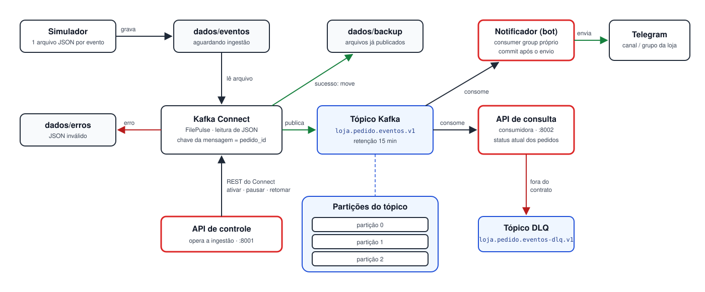

# Pipeline de Eventos da Loja

Simulação local de uma arquitetura de integração orientada a eventos, usada em aula.
Um **simulador** gera eventos de pedidos de uma loja como arquivos JSON; o **Kafka Connect**
lê esses arquivos e publica cada evento em um **tópico Kafka**; a **API de consulta** consome o
tópico e mantém o status atual de cada pedido. Uma **API de controle** liga, pausa e acompanha
a ingestão. No fim da linha, um **bot de notificação** consome o mesmo tópico e manda uma
mensagem no Telegram para cada evento.

O foco é o fluxo, os contratos e a operação — os volumes são pequenos (dezenas de pedidos,
centenas de eventos) e desempenho não é objetivo.

## Arquitetura



1. O **simulador** grava um arquivo JSON por evento em `dados/eventos/` (escrita atômica:
   `.tmp` + rename, para o Connect nunca ler um arquivo pela metade).
2. O **Kafka Connect** (plugin FilePulse) lê cada arquivo, faz o parse e publica no tópico
   `loja.pedido.eventos.v1` com chave `pedido_id`.
   - Sucesso → o arquivo é movido para `dados/backup/`.
   - JSON inválido → o arquivo é movido para `dados/erros/`.
3. O tópico tem **3 partições** e **retenção de 15 minutos**. Como a chave é o `pedido_id`, todos
   os eventos de um mesmo pedido caem na mesma partição e são lidos em ordem.
4. A **API de consulta** consome o tópico e monta uma projeção em memória. Mensagens que não
   respeitam o contrato vão para o tópico `loja.pedido.eventos-dlq.v1` (DLQ).
5. A **API de controle** opera o conector pela API REST do Kafka Connect (ativar, pausar,
   retomar, reiniciar, remover) e informa quantos arquivos estão em cada pasta.
6. O **notificador** lê o mesmo tópico, mas em um *consumer group* próprio, e envia cada evento
   como mensagem ao Telegram. Ele e a API de consulta não dependem um do outro: parar o bot não
   atrasa a API, e vice-versa.

| Componente | Tecnologia | Porta |
|---|---|---|
| Broker | Kafka 3.9 (Confluent 7.9.10), KRaft, 1 nó | 9092 |
| Ingestão | Kafka Connect 7.9.10 + FilePulse 2.18.0 | 8083 |
| API de controle | FastAPI | 8001 |
| API de consulta | FastAPI + aiokafka | 8002 |
| Notificador | Python 3.12 + aiokafka + httpx (sob demanda) | — |
| Simulador | Python 3.12 (executado sob demanda) | 9100 (métricas) |

## Eventos de um pedido

| Evento | Conteúdo | Status resultante |
|---|---|---|
| `pedido.criado` | cliente e valor em reais | `CRIADO` |
| `pedido.pagamento_aprovado` | valor e método de pagamento (Pix na simulação) | `PAGAMENTO_APROVADO` |
| `pedido.pagamento_recusado` | motivo da recusa — o pedido termina aqui | `PAGAMENTO_RECUSADO` |
| `pedido.enviado` | transportadora e código de rastreio | `ENVIADO` |

Cada pedido segue a sequência **criado → pagamento → enviado** (ou para na recusa). Vários
pedidos avançam ao mesmo tempo, com eventos intercalados. O identificador tem o formato
`PED-XXXXXXXX`.

O contrato também define eventos de entrega (`pedido.em_transito`, `pedido.saiu_para_entrega`,
`pedido.entregue`, `pedido.entrega_falhou`), aceitos pela API, mas que o simulador não gera.
O contrato completo está em [contratos/](contratos/) (modelos Pydantic + JSON Schema v1).

## Pré-requisitos

- Docker Engine 24+ (ou Docker Desktop/Colima) com Docker Compose v2 e ~4 GB de RAM livres
- GNU Make, `curl` e `jq`
- Para testes e ferramentas locais: Python 3.12 e [uv](https://docs.astral.sh/uv/)
  (`make install` cria o `.venv`)

## Configuração

```bash
cp .env.example .env
# edite CONTROLE_API_KEY (chave exigida nas rotas que alteram a ingestão)
```

As variáveis estão comentadas em [.env.example](.env.example): portas, nomes dos tópicos,
retenção (`TOPICO_RETENCAO_MS`, `RETENCAO_PROJECAO_S`), UID/GID dos containers e parâmetros do
simulador.

## Executando a simulação

```bash
make up                  # sobe kafka, connect e as duas APIs (aguarda ficarem saudáveis)
make ingestao-ativar     # cria o conector — a ingestão NÃO começa sozinha
make simular             # gera 10 eventos (padrão); ARGS="--continuo" roda sem parar
make consulta-resumo     # contagem de pedidos por status
make consulta-pedidos STATUS=ENVIADO
curl -s localhost:8002/api/v1/pedidos/<pedido_id>/eventos | jq
make down                # derruba o ambiente
```

Opções do simulador (`make simular ARGS="..."`):

| Opção | Padrão | Descrição |
|---|---|---|
| `--pedidos N` | 3 | pedidos em andamento ao mesmo tempo |
| `--intervalo-ms MS` | 500 | intervalo entre ciclos (a cada ciclo ~10% dos pedidos avançam uma etapa, no mínimo 1) |
| `--max-eventos N` | 10 | encerra após N eventos |
| `--duracao-s S` | 0 (sem limite) | encerra após S segundos |
| `--continuo` | desligado | roda até `Ctrl+C`, ignorando `--max-eventos` e `--duracao-s` |
| `--prob-falha P` | 0.15 | probabilidade de o pagamento ser recusado |
| `--seed N` | aleatório | execução reprodutível |

Exemplo: `make simular ARGS="--pedidos 20 --duracao-s 120 --seed 42"`.
`Ctrl+C` encerra o simulador sem deixar arquivos parciais.

Fora do Docker, o simulador também roda direto: `uv run python -m simulador --pedidos 3 --seed 42`.

## API de consulta

Documentação interativa em <http://localhost:8002/docs>.

| Rota | Retorno |
|---|---|
| `GET /api/v1/pedidos` | listagem paginada, com filtro opcional `?status=` |
| `GET /api/v1/pedidos/{pedido_id}` | status atual, cliente e valor |
| `GET /api/v1/pedidos/{pedido_id}/eventos` | histórico ordenado de eventos |
| `GET /api/v1/pedidos/{pedido_id}/mensagens` | avisos em HTML, prontos para um canal com `parse_mode=HTML` |
| `GET /api/v1/resumo` | indicadores agregados |
| `GET /api/v1/consumo/status` | progresso do consumo e lag |

Exemplo de mensagem:

```html
🛒 <b>Novo pedido PED-8A6A63EC</b>
Cliente: Carla · Valor: R$ 111,88
```

A API só devolve as mensagens; quem envia ao Telegram é o [notificador](#bot-de-notificação-telegram).
Os dois usam a mesma função de formatação (`contratos.formatar_mensagem`).

**Duplicidade:** a projeção descarta eventos repetidos pelo `event_id`. Reprocessar o tópico
(replay) dentro da janela de retenção não duplica o histórico nem as mensagens.

## API de controle

Documentação interativa em <http://localhost:8001/docs>. As rotas que alteram a ingestão exigem
o header `X-API-Key` com o valor de `CONTROLE_API_KEY`. Pelo Makefile:

```bash
make ingestao-status     # estado do conector e contagem de arquivos por pasta
make ingestao-ativar     # cria/ativa com a configuração versionada em controle_ingestao/conectores/
make ingestao-pausar
make ingestao-retomar
make ingestao-reiniciar
make ingestao-remover
```

## Bot de notificação (Telegram)

O notificador ([notificador/](notificador/)) consome `loja.pedido.eventos.v1` e manda uma
mensagem por evento:

```text
🛒 Novo pedido PED-6513270E
Cliente: Iara Lima · Valor: R$ 489,31

✅ Pagamento aprovado PED-6513270E
R$ 489,31 via pix

📦 Pedido enviado PED-6513270E
Correios, rastreio BR724488420
```

Ele não sobe com o `make up`: é ligado à parte, para a demonstração.

```bash
make notificador         # liga o bot
make notificador-logs    # acompanha as mensagens enviadas
make notificador-parar   # desliga
```

Sem `TELEGRAM_BOT_TOKEN` e `TELEGRAM_CHAT_ID` no `.env`, o bot roda em **modo demonstração**: faz
tudo igual, mas em vez de enviar escreve a mensagem no log (`mensagem_simulada`).

### Configurando o bot no Telegram

1. No Telegram, abra uma conversa com **@BotFather**, envie `/newbot` e escolha nome e usuário.
   Ele responde com o **token** (algo como `123456789:AA...`).
2. Crie um grupo para a aula e adicione o bot (ou use a conversa direta com ele). Envie qualquer
   mensagem no grupo.
3. Descubra o **chat_id** abrindo no navegador
   `https://api.telegram.org/bot<TOKEN>/getUpdates` e procurando `"chat":{"id":...}`. Em grupos o
   número é negativo (ex.: `-1001234567890`). Para um canal público, também vale `@nome_do_canal`,
   com o bot como administrador.
4. Preencha no `.env` e religue o bot:

   ```bash
   TELEGRAM_BOT_TOKEN=123456789:AA...
   TELEGRAM_CHAT_ID=-1001234567890
   ```

   ```bash
   make notificador
   ```

O token é um segredo: fica só no `.env` (fora do git) e não aparece nos logs.

### Roteiro para a aula

Com o ambiente no ar (`make up`, `make ingestao-ativar`) e o bot ligado (`make notificador`):

1. **Ponta a ponta.** `make simular` e as mensagens chegam no grupo: arquivo JSON → Connect →
   Kafka → bot → Telegram.
2. **Dois consumidores, um tópico.** `make consulta-resumo` mostra os mesmos eventos na API. Cada
   um tem sua própria posição de leitura no tópico; um não "consome" a mensagem do outro.
3. **O bot retoma de onde parou.** `make notificador-parar`, `make simular` e
   `make notificador-grupo`: a coluna `LAG` mostra os eventos que o bot ainda não leu. Ao rodar
   `make notificador`, ele envia exatamente esses e o lag volta a 0. Quem guarda essa posição é o
   Kafka (offset commitado do grupo), não o bot.
4. **Escalando.** `make notificador-escalar` sobe 2 instâncias no mesmo grupo; nos logs
   (`particoes_atribuidas`) e em `make notificador-grupo` dá para ver o Kafka dividindo as 3
   partições entre elas. Como a chave é o `pedido_id`, os eventos de um pedido continuam chegando
   em ordem. Volte com `make notificador`.

### Garantias e limites

- **At-least-once.** O offset só é commitado depois que a mensagem foi entregue. Se o Telegram
  falhar (rede, limite de envio, token errado), o bot tenta de novo com espera crescente e não
  pula o evento. O outro lado: se o bot cair entre enviar e commitar, aquela mensagem pode ser
  reenviada ao voltar.
- **Duplicidade.** Enquanto está no ar, o bot lembra os últimos 10 mil `event_id` enviados e não
  repete mensagem para evento duplicado no tópico.
- **Limite de envio.** O Telegram aceita ~1 mensagem/s por conversa e ~20/min em grupos; o bot
  espera `NOTIFICADOR_INTERVALO_S` (padrão 1 s) entre envios e respeita o `retry_after` quando
  recebe HTTP 429. Em grupo, rajadas grandes (`--continuo`) vão chegar com atraso.
- **Primeira execução.** Com `NOTIFICADOR_OFFSET_INICIAL=latest` (padrão), um grupo novo começa
  pelos eventos que chegarem depois de ele entrar; `earliest` envia também o que ainda estiver
  no tópico (até 15 min). Depois da primeira vez, vale sempre o offset salvo pelo grupo.
- Mensagens fora do contrato são ignoradas pelo bot; quem as desvia para o DLQ é a API de consulta.

## Alvos do Makefile

| Alvo | O que faz |
|---|---|
| `make up` / `make down` / `make clean` | sobe / derruba / derruba e apaga volumes e `dados/` (inclusive o backup) |
| `make status` / `make logs S=<serviço>` | estado dos containers / logs |
| `make simular ARGS=...` | executa o simulador em container |
| `make validar-eventos` | valida os JSON de `dados/eventos` e `dados/backup` contra o contrato |
| `make ingestao-*` | operam a ingestão via API de controle (ver acima) |
| `make topicos` / `make topicos-offsets` | configuração dos tópicos / offsets inicial e final por partição |
| `make consumir N=5` / `make dlq N=5` | lê mensagens (com chave e headers) do tópico / do DLQ |
| `make publicar-evento-teste` / `make publicar-evento-invalido` | publica direto no tópico um evento válido / fora do contrato |
| `make consulta-resumo` / `consulta-pedidos` / `consulta-consumo` | consultas rápidas à API de consulta |
| `make notificador` / `-logs` / `-parar` / `-escalar` / `-grupo` | liga, acompanha, para e escala o bot; offsets e lag do grupo |
| `make lint` / `make test` / `make test-integracao` / `make test-e2e` | qualidade e testes (ver abaixo) |
| `make build` / `make scan` / `make ci` | imagens; varredura Trivy; todos os gates |

## Verificando cada etapa

| Etapa | Comando | Resultado esperado |
|---|---|---|
| Containers | `make status` | `kafka`, `connect`, `controle-ingestao`, `api-consulta` *healthy*; `kafka-init` `Exited (0)` |
| Simulador | logs do `make simular`; `curl localhost:9100/metrics` durante a execução | linhas JSON `simulacao_resumo` a cada 10 s; `simulador_eventos_gerados_total` |
| Arquivos | `ls dados/eventos dados/backup dados/erros` | pendentes em `eventos/`, ingeridos em `backup/`, inválidos em `erros/` |
| Ingestão | `make ingestao-status` | `estado: ATIVA` e contagem `arquivos.{pendentes,em_backup,com_erro}` |
| Saúde da ingestão | `curl localhost:8001/health/ready` | `kafka_connect` e `kafka` = `ok` |
| Tópico | `make topicos`, `make topicos-offsets`, `make consumir N=5` | 3 partições, `retention.ms=900000`; chave = `pedido_id`; headers `correlation_id`, `event_type` |
| DLQ | `make publicar-evento-invalido && make dlq N=1` | mensagem com header `erro_tipo:CONTRATO_INVALIDO` |
| API de consulta | `curl localhost:8002/health/ready`, `make consulta-consumo`, `make consulta-resumo` | `catch_up_concluido: true`, `lag_total` ≈ 0, contagens por status |
| Notificador | `make notificador-logs`, `make notificador-grupo` | `particoes_atribuidas [0, 1, 2]`, uma linha `mensagem_enviada` por evento, `LAG` 0 |

**Rastreabilidade:** o `correlation_id` de um pedido é o mesmo no arquivo, no header Kafka e nos
logs das APIs. Para seguir um pedido:

```bash
ID=$(make -s consulta-pedidos | jq -r '.itens[0].correlation_id')
grep -l "$ID" dados/backup/*.json | head -1                     # arquivo de origem
make -s consumir N=500 | grep -c "correlation_id:$ID"            # mensagens no tópico
docker compose logs api-consulta | grep -c "$ID"                 # logs (nível DEBUG)
```

## Retenção de 15 minutos

- O tópico guarda mensagens por 15 min (`retention.ms`), com segmentos de 1 min para que a
  expiração ocorra de fato (entre 15 e ~17 min).
- A API de consulta aplica a **mesma janela** sobre o `occurred_at` dos eventos: eventos antigos
  são removidos a cada 30 s e o pedido deixa de existir (404) quando todos os seus eventos
  expiram. Ao reiniciar, a API relê o tópico e chega ao mesmo resultado.
- A projeção é só em memória: não há banco de dados nem deduplicação permanente.
- Os arquivos ingeridos ficam em `dados/backup` **sem limpeza automática**; remova-os com
  `make clean` ou manualmente.

## Testes

| Comando | Escopo | Requer |
|---|---|---|
| `make lint` | `ruff` (lint + format), `mypy --strict`, `pip-audit` | `.venv` |
| `make test` | unitários + contrato, cobertura mínima de 80% | `.venv` |
| `make test-integracao` | consumidor e tópicos contra Kafka real (testcontainers) | Docker |
| `make test-e2e` | fluxo completo, controle da ingestão, tópico | `make up` |
| `make test-e2e-simulacao` | simulação ponta a ponta: todos os eventos chegam à API, sem perda | `make up` |
| `make ci` | lint → test → build → scan → integração | Docker |

Os testes de contrato comparam o código com os contratos versionados em
[specs/001-pipeline-eventos-loja/contracts/](specs/001-pipeline-eventos-loja/contracts/)
(JSON Schema do evento, OpenAPI das duas APIs, configuração do conector). Toda mudança de
contrato deve atualizar esses arquivos junto.

## Solução de problemas

| Sintoma | Causa provável / ação |
|---|---|
| Arquivos ficam em `dados/eventos` e o Connect não os move | Confirme se a ingestão está `ATIVA`. Se estiver, é permissão: os containers rodam com `APP_UID`/`APP_GID` (padrão 1000) — ajuste no `.env` ou `chmod 775 dados/*`. |
| `make ingestao-status` mostra `COM_FALHA` | Veja `tarefas[].erro` e rode `make ingestao-reiniciar`. A falha conhecida do FilePulse ao pausar/retomar ("has already been shut down") é corrigida automaticamente pela API de controle (log `conector_recuperado`). |
| `estado: INEXISTENTE` | A ingestão não é ativada automaticamente: `make ingestao-ativar`. |
| `401` nas rotas de ingestão | Header `X-API-Key` diferente de `CONTROLE_API_KEY` do `.env`. |
| API de consulta `503` em `/health/ready` | Ainda relendo o tópico (catch-up) ou broker fora; veja `make consulta-consumo` e `make logs S=api-consulta`. |
| Eventos antigos misturados aos novos depois de mudar o `.env` | Recrie o conector (`make ingestao-remover && make ingestao-ativar`) e reinicie os serviços; para recomeçar do zero, `make clean && make up`. |
| Container `connect` reiniciando (exit 137 / OOM) | Pouca memória para o Docker. As JVMs têm heap fixo (broker 768 MB, Connect 1 GB); garanta ~4 GB livres. |
| Porta ocupada | Altere `*_PORTA` no `.env`. |
| `make test-integracao` falha ao subir o container Ryuk (Colima/Docker Desktop) | Rode pelo `make`, que já define `TESTCONTAINERS_DOCKER_SOCKET_OVERRIDE=/var/run/docker.sock`. |

## Estrutura do repositório

```text
simulador/           gera os eventos de pedidos como arquivos JSON (CLI + Dockerfile)
contratos/           contrato do evento (Pydantic + JSON Schema v1), compartilhado pelos serviços
controle_ingestao/   API de controle do Kafka Connect; conectores/ guarda a config versionada
api_consulta/        API de consulta: consumidor Kafka, projeção em memória, DLQ e mensagens
notificador/         bot que consome o tópico (consumer group próprio) e envia ao Telegram
infra/connect/       imagem do Kafka Connect com o plugin FilePulse
infra/kafka/         script idempotente de criação dos tópicos
tests_e2e/           testes ponta a ponta contra o ambiente em execução
dados/               eventos/, backup/ e erros/ — pastas de trabalho do Connect (fora do git)
docs/                imagens da documentação
specs/               especificação, plano, contratos e tarefas (Spec Kit)
```
